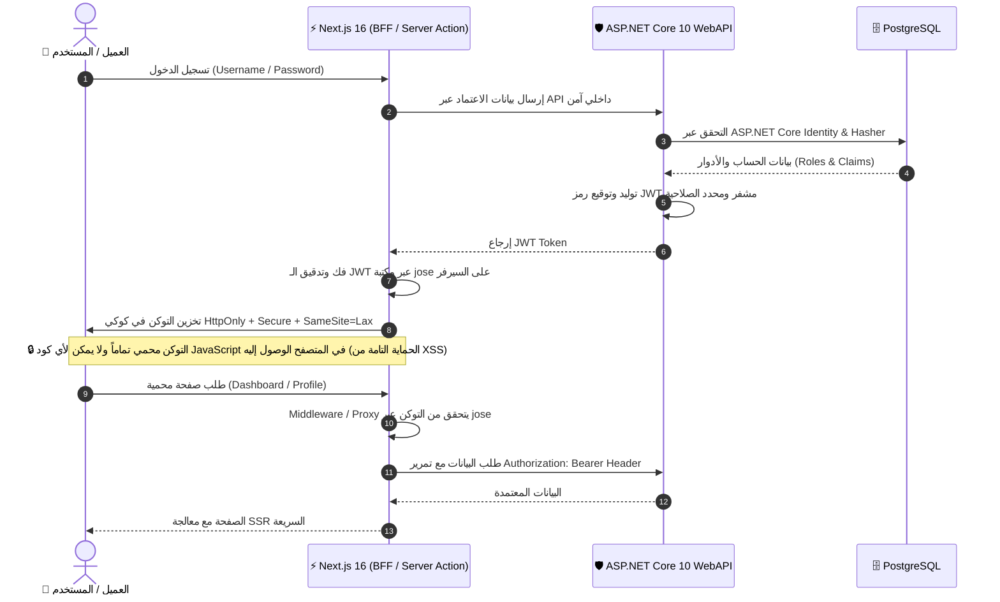

# 📍 نقطة وصل | Nogtat Wasl
### *منصة تقييم وتصنيف الأماكن والأنشطة المحلية المتكاملة*
#### *Full-Stack Local Places Ranking & Evaluation Platform*

<div align="center">


<br/>

**«نقطة وصل»** هي منصة متكاملة (Full-Stack) متطورة لتقييم واكتشاف الأماكن والأنشطة التجارية المحلية بدقة وشفافية، مبنية وفق أحدث المعايير البرمجية مع التركيز على الأداء الفائق وتجربة مستخدم عصرية وأعلى مستويات الأمان السيبراني.

[🎥 استعراض الفيديو (IFrame)](#-استعراض-المنصة-video-demo) • [🛡️ المعمارية الأمنية الفائقة](#-المعمارية-الأمنية-الفائقة-high-security-architecture) • [🖼️ معرض الصور الأصلية](#-معرض-شاشات-المنصة-screenshots-gallery) • [⚙️ التقنيات المستخدمة](#-التقنيات-المستخدمة-tech-stack) • [🚀 التشغيل والتثبيت](#-دليل-التشغيل-والتثبيت-getting-started)

</div>

---

## 🎥 استعراض المنصة (Video Demo)

استعراض تفاعلي كامل لواجهات المنصة وتجربة المستخدم ونظام المصادقة وإدارة الأماكن:

<div align="center">

<!-- تضمين مشغل اليوتيوب المباشر عبر IFrame -->
<iframe 
  width="100%" 
  height="480" 
  src="https://www.youtube.com/embed/lQR5xYPMab8?si=NogtatWaslDemo" 
  title="استعراض منصة نقطة وصل - Nogtat Wasl Demo" 
  frameborder="0" 
  allow="accelerometer; autoplay; clipboard-write; encrypted-media; gyroscope; picture-in-picture; web-share" 
  referrerpolicy="strict-origin-when-cross-origin" 
  allowfullscreen
  style="border-radius: 14px; max-width: 900px; box-shadow: 0 10px 30px rgba(0, 0, 0, 0.2);">
</iframe>

<br/><br/>

[](https://youtu.be/lQR5xYPMab8)

👉 **[اضغط هنا لمشاهدة الفيديو مباشرة على YouTube بدقة فائقة](https://youtu.be/lQR5xYPMab8)** 👈

</div>

---

## 🛡️ المعمارية الأمنية الفائقة (High-Security Architecture)

تم تصميم النظام الأمني في **نقطة وصل** ليحقق أعلى معايير الحماية المتوافقة مع بنية الويب الحديثة، من خلال الدمج الذكي بين **ASP.NET Core 10 Identity** و **Next.js 16** بمكتبة **`jose`**:



### 🔑 ركائز الأمان المطبقة:
1. **إصدار التوكن والتحقق من الهوية (Identity & JWT Issuance):**
   - خادم **ASP.NET Core 10** يتولى إدارة المستخدمين وتشفير كلمات المرور عبر **ASP.NET Core Identity**.
   - إصدار رموز **JWT (JSON Web Token)** موقعة رقمياً ومحمية بمفتاح سري مشفر، محملة ببيانات الهوية والأدوار (`Admin`, `Owner`, `Customer`).
2. **عزل التوكن عن المتصفح (HttpOnly Cookie Protection):**
   - يقوم خادم **Next.js 16** (عبر الـ Server Actions) باستقبال التوكن وتخزينه كـ **`HttpOnly` Cookie** مع تفعيل خواص `Secure` و `SameSite=Lax`.
   - هذا النهج يمنع نهائياً هجمات **XSS (Cross-Site Scripting)**، حيث يستحيل لأي سكربت خبيث قراءة رمز التوكن أو سرقته من المتصفح.
3. **التحقق والتفكيك عبر مكتبة `jose`:**
   - استخدام مكتبة **`jose`** خفيفة الوزن والمتوافقة مع Edge Runtime للتحقق اللحظي من توقيع وصلاحية التوكن وقراءة الـ Claims على مستوى خادم Next.js و Middleware دون أي تأخير في الأداء.
4. **حماية مسارات الـ Proxy و الـ Middleware:**
   - فحص وتوجيه تلقائي للمسارات العامة والمحمية قبل تحميل أي مكونات حساسة.

---

## 🖼️ معرض شاشات المنصة (Screenshots Gallery)

> *جميع الصور التالية مأخوذة مباشرة من مجلد `gallery/` المحلي بأعلى دقة ووضوح ودون أي ضغط خارجي.*

<div align="center">

### 🌟 الصفحة الرئيسية واستكشاف الأماكن المميزة
<p align="center">
  
  
</p>

### 🔍 التصنيفات والأماكن الأعلى تقييماً
<p align="center">
  
  
</p>

### 🏬 تفاصيل المكان ومعرض الصور التفاعلي
<p align="center">
  
  
</p>

### ⭐ نظام التقييمات والمراجعات التفاعلية
<p align="center">
  
  
</p>

### 🔐 بوابات تسجيل الدخول وإنشاء الحسابات
<p align="center">
  
  
</p>

### 👤 الحساب الشخصي وإدارة الملف التعريفي
<p align="center">
  
  
</p>

### 📊 لوحة تحكم أصحاب الأعمال (Owner Dashboard)
<p align="center">
  
  
</p>

### 🛠️ إضافة وإدارة الفروع والتفاصيل
<p align="center">
  
  
</p>

### 📱 تجربة المستخدم والتجاوب الكامل (Responsive Mobile UI)
<p align="center">
  
  
</p>

### ⚙️ إدارة الإعدادات والتحكم الموسع
<p align="center">
  
  
</p>

</div>

---

## ⚙️ التقنيات المستخدمة (Tech Stack)

### 🎨 الواجهة الأمامية (Frontend)
- **Framework:** [Next.js 16](https://nextjs.org/) (App Router, Server Actions, Server Components & React 19).
- **Styling:** [Tailwind CSS v4](https://tailwindcss.com/) مع دعم الوضع الليلي والمتجاوب بالكامل وتصميم عربي RTL أنيق.
- **Components:** [shadcn/ui](https://ui.shadcn.com/) المبنية على Radix و Base-UI.
- **Icons:** Lucide Icons & HugeIcons.
- **State & Data Fetching:** [TanStack React Query v5](https://tanstack.com/query/v5) و Server Actions المدمجة.
- **Validation & Forms:** React Hook Form + Zod.
- **Security & JWT:** [jose](https://github.com/panva/jose) للتحقق وفك التشفير الآمن للتوكنات في الخادم.

### 🛡️ الواجهة الخلفية (Backend)
- **Platform:** [ASP.NET Core 10](https://dotnet.microsoft.com/) WebAPI.
- **Architecture:** Clean Architecture (Domain, Application, Infrastructure, WebAPI).
- **Security & Identity:** ASP.NET Core Identity + JWT Bearer Authentication.
- **ORM & Database:** Entity Framework Core 10 مع قاعدة بيانات **PostgreSQL** (`Npgsql.EntityFrameworkCore.PostgreSQL`).
- **API Documentation:** OpenAPI / Scalar Interactive API Documentation.
- **Containerization:** Docker & Docker Compose.

---

## ✨ المميزات الرئيسية للمنصة (Key Features)

- 🔍 **استكشاف وتصفح ذكي:** استعراض الأماكن حسب التصنيف، المدينة، الأعلى تقييماً، والأحدث إضافة.
- ⭐ **نظام مراجعات وتقييمات حقيقي:** كتابة تقييمات تفاعلية، إضافة صور للتجربة، واحتساب متوسط التقييم بدقة.
- 🏢 **لوحة مخصصة لأصحاب الأنشطة التجارية (Store Owners):**
  - إضافة الأماكن وتحديث بيانات التواصل والموقع الجغرافي وساعات العمل.
  - رفع وإدارة معارض الصور التفاعلية.
  - مراقبة آراء الزبائن والرد على الاستفسارات.
- 👮 **إدارة وصلاحيات متقدمة (Role-Based Access Control):**
  - دعم الأدوار: مستخدم عادي (`Customer`)، صاحب عمل (`Owner`)، ومدير نظام (`Admin`).
- ⚡ **أداء خيالي وسرعة استجابة:** بفضل معمارية Next.js 16 Server Components والتوليد المتزامن للواجهات.
- 📱 **واجهة مستخدم متجاوبة وشاملة:** تجربة سلسة وتفاعلية على الشاشات الكبيرة والمكتبية والهواتف الذكية.

---

## 📂 هيكلية المشروع (Project Structure)

```text
Local-Places-Ranking-and-Evaluation-API/
├── Application/                 # طبقة منطق الأعمال والوسائط (CQRS / Services / Interfaces)
├── Core/                        # طبقة النطاق والكيانات الأساسية (Entities / Domain Models)
├── infrastructural/            # طبقة البنية التحتية والوصول للبيانات (EF Core DbContext / Repositories)
├── WebAPI/                      # طبقة الواجهات البرمجية وتكوين الخدمات (Controllers / Endpoints)
│   ├── Controllers/             # وحدات التحكم (Admin, Owner, Customer, Reviews...)
│   ├── ApiDependencyInjection.cs# ربط خدمات الـ JWT و Identity و Database
│   └── Program.cs               # نقطة انطلاق ASP.NET Core 10
├── frontend/                    # تطبيق الواجهة الأمامية (Next.js 16)
│   ├── app/                     # مسارات App Router (الرئيسية، الأماكن، التقييمات، المصادقة)
│   │   ├── (app)/               # الصفحات العامة وتفاصيل الأماكن
│   │   ├── (auth)/              # تسجيل الدخول وإنشاء الحساب
│   │   └── api/                 # مسارات الـ API Proxy الداخلية
│   ├── lib/                     # مكتبات الأمان، إدارة الجلسات (jwt.ts, session.ts, actions.ts)
│   ├── components/              # مكونات الواجهة التفاعلية و shadcn/ui
│   └── proxy.ts                 # معالج الوسيط والتحقق من التوكن
├── gallery/                     # مجلد لقطات الشاشة الأصلية بجودة فائقة
├── compose.yaml                 # إعدادات Docker Compose لقواعد البيانات
└── README.md                    # التوثيق الشامل للمشروع
```

---

## 🚀 دليل التشغيل والتثبيت (Getting Started)

### 1. المتطلبات المسبقة (Prerequisites)
- تثبيت [.NET 10 SDK](https://dotnet.microsoft.com/download/dotnet/10.0).
- تثبيت [Node.js 20+](https://nodejs.org/) و [pnpm](https://pnpm.io/).
- تثبيت خادم [PostgreSQL](https://www.postgresql.org/) أو تشغيل [Docker Desktop](https://www.docker.com/).

### 2. إعداد قاعدة البيانات والواجهة الخلفية (Backend)
```bash
# الانتقال لمجلد المشروع الرئيسي
cd Local-Places-Ranking-and-Evaluation-API

# تشغيل حاوية قاعدة البيانات (اختياري عبر Docker)
docker compose up -d

# الانتقال إلى مشروع الـ API
cd WebAPI

# تحديث قاعدة البيانات بتطبيق المايجريشن
dotnet ef database update --project ../infrastructural

# تشغيل خادم الـ API
dotnet run
```
*سيعمل خادم الـ API تلقائياً على `https://localhost:7000` أو `http://localhost:5000` مع توثيق Scalar API على مسار `/scalar/v1`.*

### 3. إعداد الواجهة الأمامية (Frontend)
```bash
# الانتقال إلى مجلد الواجهة الأمامية
cd ../frontend

# تثبيت الحزم والاعتماديات
pnpm install

# إعداد المتغيرات البيئية (.env.local)
cp .env.example .env.local
```

تأكد من ضبط المتغيرات البيئية في ملف `.env.local`:
```env
NEXT_PUBLIC_API_URL=https://localhost:7000/api
ASP_NET_JWT_SECRET=YourSuperStrongSecureKeyMatchingAspNetCoreSettings32Chars
ASP_NET_JWT_ISSUER=YourIssuerName
ASP_NET_JWT_AUDIENCE=YourAudienceName
```

ثم ابدأ خادم التطوير:
```bash
pnpm dev
```
*افتح المتصفح وتوجه إلى [http://localhost:3000](http://localhost:3000) لتجربة المنصة.*

---

## 👨‍💻 المطور (Author)

تم بناء وتطوير المشروع بواسطة:
- **مشعل جمال (Meshaal Jamal)**
- GitHub: [@mesh3aal](https://github.com/mesh3aal)
- البريد الإلكتروني: [`meshaal.j@hotmail.com`](mailto:meshaal.j@hotmail.com)

---

<div align="center">
⭐ إذا نال المشروع إعجابك، لا تنسَ ترك نجمة على المستودع لدعم استمرار التطوير! ⭐
</div>
